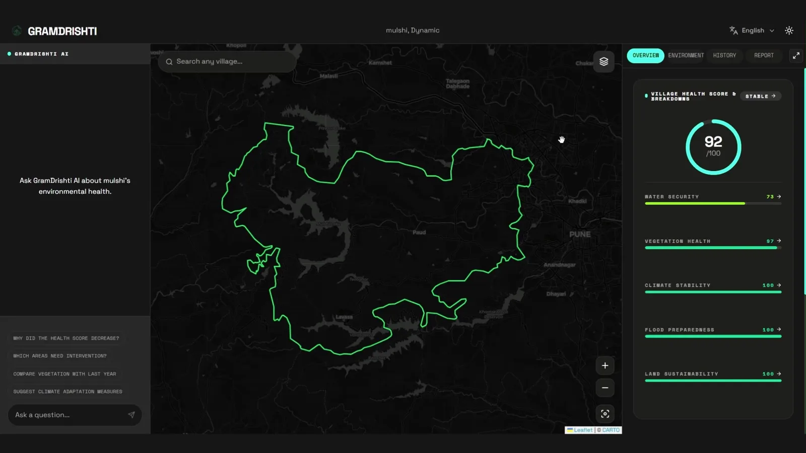

 

 

&nbsp;

&nbsp;

  

  

 

I'm a third-year Electronics and Telecommunication Engineering student at PICT, Pune (CGPA 9.31), currently working as a Software Engineer Intern at MindstriX Technologies LLP, where I focus on LLM integration, API development, and AI R&D. I build systems at the intersection of AI, mobile, and real-world impact, from production Gemini Vision pipelines to dual-microcontroller computer vision hardware.

My interest lies in Computer Vision, Embedded Systems, and Intelligent Automation. I enjoy building real-world systems that combine software, hardware, and machine learning to solve practical problems, whether that's a pothole-detection rig fusing YOLOv8 with a dual ESP32 architecture, a dynamic traffic signal system that reads live vehicle density, or an AI governance layer for agricultural insurance claims. I believe the best way to learn engineering is by building, experimenting, debugging, and improving real systems, not just studying theory.

That approach has paid off on the competition circuit: 1st place at TechFiesta '26 (International, Agriculture domain), 1st place in the Agritech domain at HackVenture 2K26, a Runner-Up finish at the Pune Agri International Hackathon, where our AI-powered agricultural governance platform was presented to and recognized by the Maharashtra CM, Agriculture Minister, and Higher & Technical Education Minister, and a Top 3 finish among 600+ teams at VOIS Innovation Marathon 2.0. My Intelligent Pothole Detection System work has also been published as peer-reviewed research with its own DOI.

<strong>Currently building:</strong> AI-native Android systems integrating the Gemini API with real-world sensor data.

 

 

<table width="100%">
<tr>
<th align="center">Place</th>
<th align="center">Competition</th>
<th align="center">Scope</th>
</tr>
<tr>
<td align="center">🥇 <strong>1st Place</strong></td>
<td align="center">TechFiesta '26</td>
<td align="center">International</td>
</tr>
<tr>
<td align="center">🥇 <strong>1st Place</strong></td>
<td align="center">HackVenture 2K26</td>
<td align="center">National</td>
</tr>
<tr>
<td align="center">🥈 <strong>Runner-Up</strong></td>
<td align="center">Pune Agri International Hackathon</td>
<td align="center">International</td>
</tr>
<tr>
<td align="center">🏁 <strong>Top 3</strong></td>
<td align="center">VOIS Innovation Marathon 2.0 (Vodafone Idea Foundation)</td>
<td align="center">National</td>
</tr>
</table>

 

 

### 🥇 TechFiesta '26 · International Gold

<table width="100%">
<tr>
<td width="33%"></td>
<td width="33%"></td>
<td width="33%"></td>
</tr>
</table>

 

### 🥇 HackVenture 2K26 · Agritech Winner

<table width="60%">
<tr>
<td></td>
</tr>
</table>

 

### 🥈 Pune Agri International Hackathon · Runner-Up

Presented to the Maharashtra CM, Agriculture Minister, and Higher & Technical Education Minister.

<table width="100%">
<tr>
<td width="33%"></td>
<td width="33%"></td>
<td width="33%"></td>
</tr>
</table>

 

### 🏁 VOIS Innovation Marathon 2.0 · Top 3 of 600+ Teams

<table width="100%">
<tr>
<td width="50%"></td>
<td width="50%"></td>
</tr>
<tr>
<td width="50%"></td>
<td width="50%"></td>
</tr>
</table>

 

 

**AI / ML**

  

**Backend / APIs**

  

**Mobile & Embedded**

  

**Frontend & Tools**

  

 

<table width="100%">
<tr>
<th align="center">Project</th>
<th align="center">Description</th>
<th align="center">Stack</th>
<th align="center">Link</th>
</tr>
<tr>
<td align="center"><strong>Aviro</strong></td>
<td>Invariant-governed AI Finance Controller architecture bridging probabilistic AI systems and deterministic accounting rules, built to guarantee zero unauthorized capital movement and zero false auto-matches.</td>
<td>Python · Fintech · Rule Engine</td>
<td align="center"><a href="https://github.com/SanTiwari07/Aviro">View</a></td>
</tr>
<tr>
<td align="center"><strong>Sudarshan</strong></td>
<td>Android malware analysis and banking threat intelligence platform combining static analysis, Frida-based dynamic sandboxing, deterministic risk scoring, and MITRE ATT&CK mapping, built for CyberShield Hackathon 2026 at IIT Hyderabad.</td>
<td>Python · Frida · Androguard · YARA</td>
<td align="center"><a href="https://github.com/SanTiwari07/Sudarshan">View</a></td>
</tr>
<tr>
<td align="center"><strong>IPDS v2.0</strong></td>
<td>Dual ESP32 pothole detection: YOLOv8-Nano (mAP 81.68%, Precision 82.33%), MPU6050 inertial sensor fusion, NEO-6M GPS mapping. Published with its own DOI.</td>
<td>Python · YOLOv8 · ESP32-CAM · C++</td>
<td align="center"><a href="https://github.com/SanTiwari07/PotHoleDetection">View</a></td>
</tr>
<tr>
<td align="center"><strong>InsureRoute</strong></td>
<td>Smart supply-chain intelligence and dynamic-pricing engine: AI-powered logistics intelligence with real-time weather monitoring, algorithmic rerouting, and actuarial risk hedging.</td>
<td>Python · Actuarial Modeling</td>
<td align="center"><a href="https://github.com/SanTiwari07/InsureRoute">View</a></td>
</tr>
<tr>
<td align="center"><strong>KrishiSahAI</strong></td>
<td>AgriTech advisory platform bringing AI to the Indian farmhouse, turning agriculture into a data-driven, sustainable, and more profitable enterprise for farmers.</td>
<td>Flask · LangChain · Ollama · TensorFlow</td>
<td align="center"><a href="https://github.com/SanTiwari07/KrishiSahAI">View</a></td>
</tr>
<tr>
<td align="center"><strong>Smart Traffic Flow Analyzer</strong></td>
<td>Real-time traffic signal optimization: YOLOv8 and SORT-based vehicle detection dynamically adjusting signal timings based on live density, interfaced with ESP32.</td>
<td>Python · OpenCV · YOLO · ESP32</td>
<td align="center"><a href="https://github.com/SanTiwari07/SmartTrafficFlowAnalyzer">View</a></td>
</tr>
<tr>
<td align="center"><strong>Portfolio</strong></td>
<td>Personal portfolio site with an interactive 3D Porsche 911 Turbo S showroom, smooth interactions, and responsive layouts.</td>
<td>TypeScript · React · Three.js</td>
<td align="center"><a href="https://github.com/SanTiwari07/Portfolio">View</a></td>
</tr>
</table>

 

 

<table width="100%">
<tr>
<th align="center">Role</th>
<th align="center">Company</th>
<th align="center">Duration</th>
<th align="center">Focus Areas</th>
</tr>
<tr>
<td align="center"><strong>Software Engineer Intern</strong></td>
<td align="center">MindstriX Technologies LLP</td>
<td align="center">March 2026 – Present (Remote)</td>
<td align="center">LLM Integration · API Development · AI R&D</td>
</tr>
</table>

 

 

 

 

 

 

<picture>
  <source media="(prefers-color-scheme: dark)" srcset="https://raw.githubusercontent.com/SanTiwari07/SanTiwari07/output/pacman-contribution-graph-dark.svg">
  <source media="(prefers-color-scheme: light)" srcset="https://raw.githubusercontent.com/SanTiwari07/SanTiwari07/output/pacman-contribution-graph.svg">
  
</picture>

  

 

